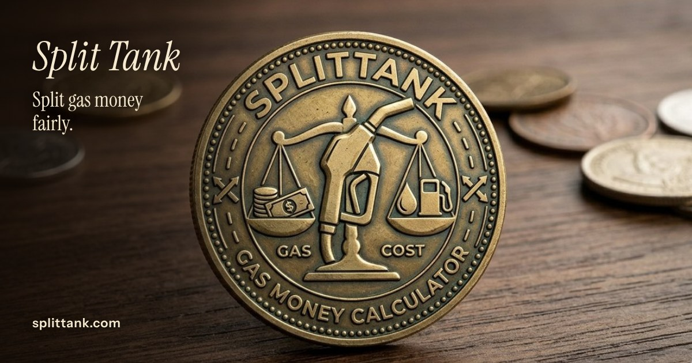

# Split Tank

**Live app: [splittank.com](https://splittank.com)**

Split Tank works out how much each person owes for gas on a road trip or carpool. Enter the route, pick the car, set the number of passengers, and everyone sees their share with a payment link that already has the amount filled in.

There is no sign in and no account. Every calculation lives in the page and in the link you share.



## How it works

1. **Trip.** Enter a start and end address to calculate miles, tolls, and a weighted average gas price for trips that cross state lines. You can also type the miles in directly. "Use My Location" detects your state, and the gas price fills in from live AAA and EIA data.
2. **Car.** Choose year, make, model, and trim. MPG comes from the U.S. Department of Energy's FuelEconomy.gov database. Electric mode uses EPA efficiency data and a $/kWh rate instead.
3. **Crew.** Set the number of passengers (0 for a solo trip) and choose an even split, passengers covering the driver, or custom percentages per passenger.
4. **Total.** The result updates as you type. There is no submit button.
5. **Pay.** The driver adds their Venmo, Cash App, Zelle, or Apple Pay details. Passengers get a payment link with the amount prefilled, or the driver can send a payment request by text.

## Features

- **Route calculator.** OSRM computes the driving route and distance, plus a city and highway split that blends the car's city and highway MPG.
- **Multistate trips.** A local point in polygon lookup against U.S. Census state boundaries finds every state on the route without an API call per point, then shows a weighted average gas price and suggests where to fill up.
- **Live gas prices.** AAA daily state averages, with EIA weekly data as the fallback and 2024 static averages if both are down. Prices are cached in the browser.
- **Toll estimates.** TomTom routing, with an OpenStreetMap toll booth fallback, adjusted for inflation and vehicle type.
- **Vehicle lookup.** A year, make, model, and trim cascade backed by FuelEconomy.gov, including EPA range and mi/kWh for electric vehicles.
- **Flexible splits.** Even, driver covered, or custom percentages, with a picker so each passenger can find their own share in a shared link.
- **Payment deep links.** Venmo and Cash App open with the exact amount filled in. Zelle and Apple Pay are supported, and the driver can text a request directly.
- **Shareable links.** "Copy link" encodes the whole trip (miles, state, split mode, percentages, payment handles) in the URL, so anyone who opens it sees a complete, payable result.

## Architecture

| Layer | What it uses |
|---|---|
| Front end | React 19, Vite, react-simple-maps, d3-geo, TopoJSON |
| Serverless API (`api/`) | Vercel functions that proxy gas prices, electricity rates, geocoding, and tolls so API keys stay off the client |
| Edge | Vercel Edge Middleware that serves link previews to social media bots |
| External data | FuelEconomy.gov, EIA, AAA, OSRM, OpenStreetMap Nominatim and Photon, Census TIGER, Mapbox (optional), TomTom (optional), Overpass |
| Hosting | Vercel, deployed automatically from `main` |

Each external source has a fallback, so the app still returns a result when one service is slow or down.

## Run it locally

```bash
git clone https://github.com/Chidubem5/splittank.git
cd splittank
npm install
cp .env.local.example .env.local
# Optional: add an EIA API key and/or a Mapbox token to .env.local
npm run dev
```

The app runs without either key. It falls back to static gas prices and OpenStreetMap and Census geocoding.

## Tests

```bash
npm test
```

Vitest covers the calculation helpers in `src/utils/` and `src/api/`: split math, text message deep link building, contact parsing, trim ranking, county name normalization, and gas price handling.

## Author

Built by [Franklin Umeh](https://chidu.dev). Feedback and issues are welcome.
